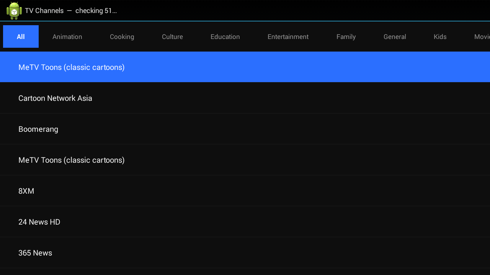
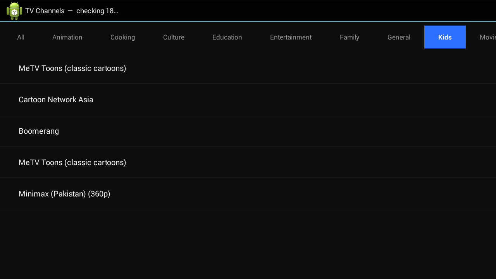

<div align="center">


# 📺 NDV TV — Lightweight IPTV Player for Old Android TVs

### A tiny, fast live‑TV & IPTV app that actually runs on **Android 4.4 KitKat** (API 19)

<sub>by <a href="https://nowdigiverse.com">Nowdigiverse</a></sub>

Revive an old smart TV or Android TV box with a modern **ExoPlayer / Media3** engine, **M3U playlist** support, category tabs, and automatic dead‑channel filtering — in a **590 KB** APK.

<br>


-orange)


</div>

---

## 🤖 Easiest install — just ask Claude

**No Android skills needed.** If you use **[Claude Code](https://claude.com/claude-code)**, point it at this repo and let it do the whole job — clone, build, and install the app straight onto your TV over your network:

> 💬 **“Clone `https://github.com/thisisfaizi/tv-channels`, build it, and install the app on my Android TV at `<TV_IP>`.”**

Claude sets up the SDK, builds the APK, and installs it via ADB — the channel app just appears on your TV. 🎉

<sub>Prefer to do it yourself? Grab the ready‑made [**APK from Releases**](https://github.com/thisisfaizi/tv-channels/releases/latest) or follow [Build from source](#️-build-from-source).</sub>

---

## 🎯 Why this exists

Old smart TVs and Android TV boxes (CVTE, HiSilicon, and similar **Android 4.4 KitKat** devices) are stranded: **they can't be upgraded**, the Play Store is dead or empty, Netflix/YouTube apps refuse to install, and modern IPTV players require Android 8+.

Even **VLC** struggles on these devices — it crashes on many live HLS streams, shows a certificate warning on *every* channel, and gets blocked (HTTP 403) by CDNs that filter its User‑Agent.

**TV Channels** fixes all of that in one small, remote‑friendly app, so a 2015‑era TV can stream live channels again.

> ⚠️ This app ships with a short list of **free, publicly available** demo streams and loads **your own M3U playlists**. It is a *player* only — it hosts no content and is **not affiliated with any channel or broadcaster**. Use only streams you are legally allowed to access.

---

## ✨ Features

| | Feature | What it does |
|---|---|---|
| 🧩 | **Category tabs** | Channels grouped by type (Kids, News, Entertainment, Music…), fully **D‑pad / TV‑remote navigable** |
| 🧹 | **Auto‑hide dead channels** | Background checker probes every stream and hides any that 404, time out, or get blocked — results cached |
| 🎚️ | **Adjustable quality** | Toggle **Low → Auto → High (HD)** live while watching; remembered between sessions |
| 🔒 | **Fixes KitKat TLS** | Installs modern root CAs + forces **TLS 1.2** so today's HTTPS CDNs work — **no certificate pop‑ups** |
| 🕵️ | **User‑Agent spoofing** | Sends a desktop‑browser User‑Agent so UA‑filtered CDNs stop returning **403 Forbidden** |
| 🎬 | **Robust HLS playback** | **Media3 ExoPlayer** handles live `.m3u8` streams that make VLC crash |
| 📄 | **M3U / M3U8 playlists** | Drop your own `.m3u` files on the device and they load automatically |
| 🪶 | **Tiny & fast** | ~590 KB APK, no bloat, `minSdk 19`, runs in 512 MB RAM |

<div align="center">
<br>

&nbsp;

</div>

---

## 🆚 NDV TV vs VLC on Android 4.4

| | VLC on KitKat | **NDV TV** |
|---|:---:|:---:|
| Live HLS (`.m3u8`) streams | ❌ crashes on many | ✅ plays smoothly |
| Certificate pop‑ups | ❌ on every channel | ✅ none |
| UA‑blocked channels (HTTP 403) | ❌ blocked | ✅ works |
| Category tabs | ❌ | ✅ |
| Auto‑hide dead channels | ❌ | ✅ |
| Video quality toggle | manual | ✅ Low / Auto / High |
| App size | ~48 MB | ✅ **~0.6 MB** |

---

## 🧠 How it works (the three KitKat fixes)

Running modern streaming on Android 4.4 means solving three separate problems most apps ignore:

### 1. TLS 1.2 is disabled by default on API 16–19
`HttpsURLConnection` on KitKat negotiates TLS 1.0 by default, so the handshake with modern CDNs (Akamai, Let's Encrypt, Sectigo) fails before anything downloads. The app wraps the socket factory to **force `TLSv1.2`** on every socket.

### 2. The CA store is from ~2018
KitKat doesn't trust newer roots (e.g. ISRG / Let's Encrypt), so certificates fail validation. Instead of a dangerous "trust everything" shortcut, the app **bundles current root certificates** (`res/raw/roots.pem`) and builds a real `TrustManager` — validation stays on, pop‑ups go away.

### 3. CDNs block the player's User‑Agent
Some channels return **403 Forbidden** to non‑browser clients. The app sets a **desktop Chrome User‑Agent** on every request via `DefaultHttpDataSource`, so those streams serve normally.

The result: streams that **403, prompt, or crash in VLC** play cleanly here.

---

## 🎮 Remote controls

| Button | Action |
|---|---|
| **◀ ▶** | Switch category tab (list updates instantly) |
| **▼** | Move focus down into the channel list |
| **▲** | Back up to the tabs — **or, while playing, cycle video quality** |
| **OK / Center** | Play the highlighted channel |
| **MENU** | Cycle video quality (Low → Auto → High) while playing |
| **Back** | Return to the channel list |

---

## 📄 Playlist format

Create a standard **M3U** file and place it at `/sdcard/pakistan.m3u` or `/sdcard/cartoons.m3u` (it loads automatically alongside the built‑in list):

```m3u
#EXTM3U
#EXTINF:-1 group-title="News",My News Channel
https://example.com/news/live.m3u8
#EXTINF:-1 group-title="Kids",My Cartoon Channel
https://example.com/cartoons/live.m3u8
```

- `group-title="…"` becomes the **category tab**.
- The text after the comma is the **channel name**.
- The next line is the **stream URL** (HLS `.m3u8` recommended).

---

## 🛠️ Build from source

**Requirements:** JDK 17, Android SDK (compileSdk 34), Gradle 8.14 (wrapper included).

```bash
git clone https://github.com/thisisfaizi/tv-channels.git
cd tv-channels

# point Gradle at your JDK 17 and Android SDK
export JAVA_HOME="/path/to/jdk-17"
echo "sdk.dir=/path/to/Android/sdk" > local.properties

./gradlew assembleRelease
```

The signed APK lands at `app/build/outputs/apk/release/app-release.apk`.

### Install on your TV over the network (ADB)

```bash
adb connect <TV_IP>:5555
adb -s <TV_IP>:5555 install -r app/build/outputs/apk/release/app-release.apk
adb -s <TV_IP>:5555 shell am start -n com.faizi.tvchannels/.MainActivity
```

---

## 🧱 Tech stack

- **Language:** Java (no Kotlin runtime dependency)
- **Player:** AndroidX **Media3 ExoPlayer 1.4.1** + `media3-exoplayer-hls`
- **UI:** Native Android views (no AppCompat) for a minimal footprint
- **Build:** Android Gradle Plugin 8.11, R8 shrinking (keeps it under the 64K method limit without multidex)
- **Min / Target SDK:** 19 / 28 · **compileSdk:** 34

---

## 📱 Compatibility

- ✅ **Android 4.4 KitKat (API 19)** and up
- ✅ CVTE / HiSilicon smart‑TV boards, generic Android TV boxes, tablets
- ✅ Works with a standard **TV remote (D‑pad)** — no touchscreen needed
- 💡 **Tip:** live video needs real bandwidth. Over weak Wi‑Fi, high‑bitrate channels will buffer — use **Low** quality, or connect the TV by **Ethernet** for the best experience.

---

## 🗺️ Roadmap

- [ ] Remember last‑watched channel
- [ ] Favourites / pin channels
- [ ] On‑screen channel search
- [ ] EPG (programme guide) support
- [ ] Import playlist from a URL

Contributions welcome — open an issue or PR.

---

## 📝 License

[MIT](LICENSE) © 2026 Faizi

---

<div align="center">

**Keywords:** Android 4.4 IPTV player · KitKat live TV app · ExoPlayer Media3 minSdk 19 · old Android TV box streaming · M3U / M3U8 HLS player · fix TLS 1.2 on KitKat · fix HTTP 403 User‑Agent · lightweight Android TV app · revive old smart TV · free live TV Android

</div>
